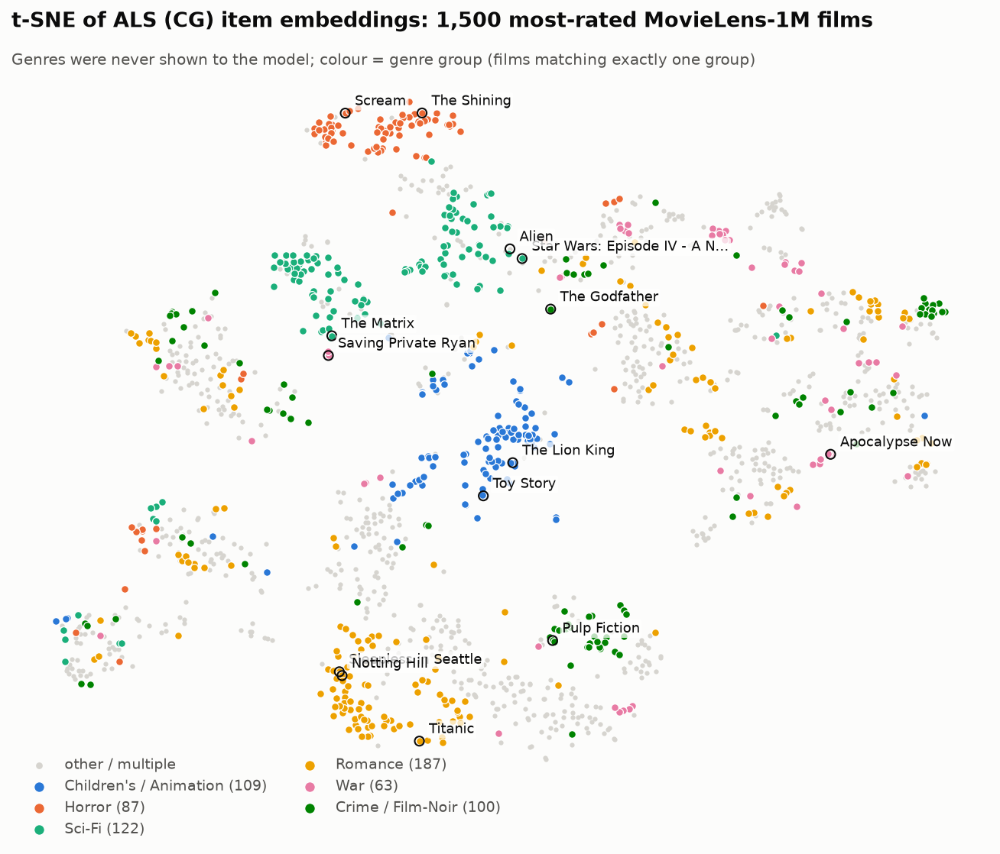
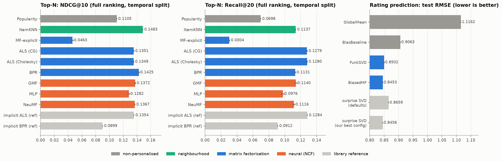
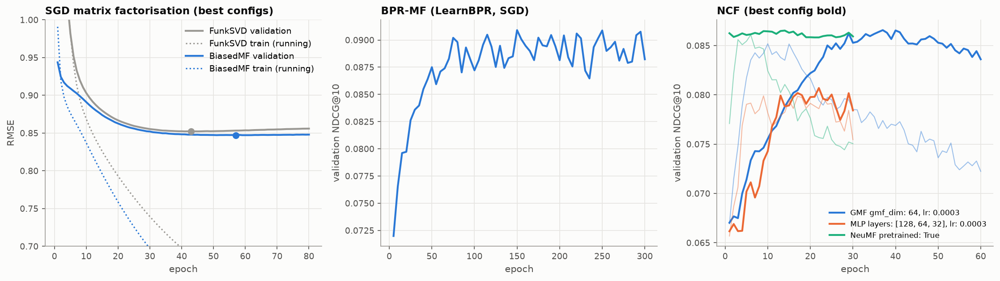
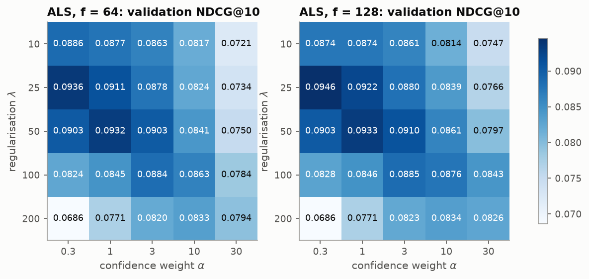
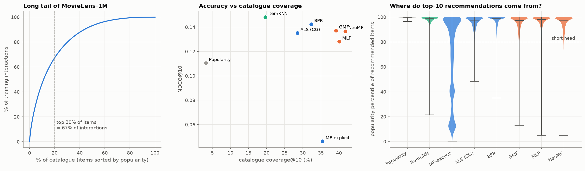
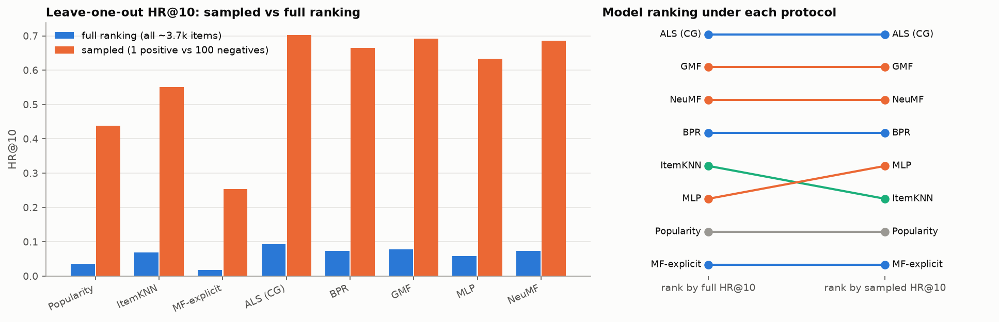

# recsys-matrix-factorization

Recommender systems from scratch on MovieLens-1M: biased matrix factorisation, implicit ALS, BPR, item-kNN and Neural Collaborative Filtering, compared with full-ranking metrics.

[](https://github.com/Jai-Advitheeya-Lella/recsys-matrix-factorization/actions/workflows/tests.yml)



*Hero: t-SNE of the item factors of an implicit ALS model trained only on who rated what. Genre labels were never seen by the model, yet films of the same genre group cluster together: the 10 nearest neighbours of a film (cosine distance in factor space) share its genre group 85% of the time, against 19% for shuffled labels.*

This is a from-scratch reimplementation for learning and research. The algorithms are written with NumPy, numba and PyTorch tensor operations; `scikit-surprise` and `implicit` are used only as reference baselines to compare against.

## Highlights

- **Models implemented from scratch**: Funk-SVD and biased MF trained with SGD (numba), weighted ALS for implicit feedback with both an exact Cholesky solver and a conjugate-gradient solver (Hu, Koren & Volinsky 2008; Takacs et al. 2011), BPR-MF with LearnBPR sampling (Rendle et al. 2009), item-kNN, and GMF / MLP / NeuMF in PyTorch (He et al. 2017). Popularity and bias-only baselines are included.
- **Rating prediction**: biased MF reaches test RMSE **0.8453** (mean of 3 seeds, std 0.0001) on a random 90/10 split; `scikit-surprise` SVD with the same hyper-parameters gets 0.8456, and with its defaults 0.8659.
- **Top-N recommendation with full ranking** (no sampled metrics) on a per-user temporal split. A tuned item-kNN is the strongest model on NDCG@10 (0.1483), BPR-MF follows (0.1425), ALS has the best Recall@20 (0.1279), and NeuMF (0.1367) does not beat the dot-product models, in line with Rendle et al. (2020).
- **The ALS implementation agrees with the `implicit` library** (NDCG@10 0.1351 vs 0.1354 with identical hyper-parameters), and the CG solver is about 6x faster than the Cholesky solver at 64 to 256 factors while reaching an objective within 0.14% of the exact one.
- **Sampled metrics are misleading**: under leave-one-out, ALS HR@10 is 0.0935 with full ranking but 0.7028 when the held-out item is ranked against 100 random negatives, and the ordering of ItemKNN and MLP flips.
- **32 tests**: SGD and BPR gradient checks against finite differences, ALS normal equations, CG convergence to the exact solve, agreement with `implicit`'s solver, metric definitions, split invariants.

## Results

Hardware: Intel Core Ultra 7 270K Plus (24 threads; every run capped at 4 threads) and one NVIDIA RTX 5070 Ti (used for NCF only). The machine was shared with other jobs while the experiments ran, so wall-clock fit times are only reported where they were re-measured on an idle machine (ALS table below).



### Rating prediction (explicit feedback)

MovieLens-1M, 1,000,209 ratings from 6,040 users on 3,706 movies. Random 90/10 split (seed 0); hyper-parameters grid-searched on a 10% validation slice of the training set, with the number of SGD epochs chosen on validation; the final models are refit on the full 90% and scored on the 10% test set. Mean ± std over 3 initialisation seeds.

| Model | test RMSE | test MAE |
|---|---|---|
| GlobalMean | 1.1162 | 0.9335 |
| BiasBaseline | 0.9063 | 0.7178 |
| FunkSVD | 0.8502 ± 0.0003 | 0.6708 ± 0.0002 |
| BiasedMF | 0.8453 ± 0.0001 | 0.6653 ± 0.0003 |
| surprise SVD (defaults) | 0.8659 | 0.6796 |
| surprise SVD (our best config) | 0.8456 | 0.6655 |

Selected for biased MF: 200 factors, learning rate 0.005, regularisation 0.05, 57 epochs. Adding user and item biases improves on plain Funk-SVD (0.8502), and a well-regularised SGD model matches the reference implementation once the hyper-parameters are aligned; `surprise`'s default configuration (regularisation 0.02, 20 epochs) is not tuned for this dataset.

### Top-N recommendation (implicit feedback)

Every rating is treated as a positive interaction. Protocol: for each user the last 20% of their interactions (chronologically) form the test set; the last 12.5% of the remaining interactions (10% overall) are the validation set used for hyper-parameter search and early stopping; final models are refit on train + validation. Metrics use **full ranking**: every item the user has not interacted with in training is a candidate. Stochastic models are averaged over 3 seeds (± is the std over seeds; item-kNN and popularity are deterministic). Coverage, Gini and average popularity describe the top-10 lists; coverage@10 is the share of the 3,706-film catalogue that appears in at least one user's top 10.

| Model | NDCG@10 | Recall@20 | HR@10 | coverage@10 | Gini@10 | avg. popularity of top-10 |
|---|---|---|---|---|---|---|
| Popularity | 0.1105 | 0.0698 | 0.448 | 3.2% | 0.994 | 2323 |
| ItemKNN | 0.1483 | 0.1137 | 0.595 | 19.6% | 0.966 | 1628 |
| MF-explicit | 0.0463 ± 0.0012 | 0.0304 ± 0.0004 | 0.269 | 35.5% | 0.941 | 682 |
| ALS (CG) | 0.1351 ± 0.0004 | 0.1279 ± 0.0003 | 0.590 | 28.5% | 0.913 | 1215 |
| ALS (Cholesky) | 0.1349 ± 0.0003 | 0.1280 ± 0.0004 | 0.591 | 28.5% | 0.913 | 1214 |
| BPR | 0.1425 ± 0.0014 | 0.1131 ± 0.0010 | 0.600 | 32.3% | 0.942 | 1592 |
| GMF | 0.1372 ± 0.0005 | 0.1140 ± 0.0012 | 0.577 | 39.2% | 0.908 | 1299 |
| MLP | 0.1282 ± 0.0013 | 0.0976 ± 0.0013 | 0.550 | 40.1% | 0.921 | 1395 |
| NeuMF | 0.1367 ± 0.0001 | 0.1116 ± 0.0011 | 0.574 | 41.7% | 0.907 | 1310 |
| implicit ALS (ref) | 0.1354 | 0.1284 | 0.591 | 28.4% | 0.914 | 1218 |
| implicit BPR (ref) | 0.0899 | 0.0912 | 0.473 | 84.0% | 0.598 | 467 |

Observations:

- **Tuned baselines are strong.** Plain popularity already reaches NDCG@10 0.1105, and item-kNN beats every learned model on NDCG@10. The advantage disappears on Recall@20, where ALS is clearly ahead (0.1279 vs 0.1137), so the ranking of models depends on the metric.
- **NCF does not beat matrix factorisation here.** GMF (0.1372) and NeuMF (0.1367) are on par with ALS (0.1351) and below BPR (0.1425); the MLP alone is worse (0.1282). The NCF models were tuned on a small grid (2 configurations each), so these numbers are not a ceiling for NCF, but they are consistent with Rendle et al. (2020): a dot product is hard to beat when it is tuned properly.
- **Explicit-rating MF is the wrong tool for ranking**: biased MF trained on ratings reaches NDCG@10 0.0463 because it predicts how much a user would like a film, not whether they will watch it.
- `implicit ALS (ref)` matches our ALS. `implicit BPR (ref)` is run with *our* tuned BPR hyper-parameters, which do not transfer to that library's learning-rate and regularisation conventions, so its low score is not a verdict on its quality; it is listed to show that the evaluation pipeline accepts external models.

Tuning (validation NDCG@10; each model's grid is stored in `results/tune/`). Two selected values sit on the edge of their grid (item-kNN `k = 1000`, ALS `alpha = 0.3`), so slightly better settings may exist.

| Model | selected on validation NDCG@10 | grid size | val. NDCG@10 |
|---|---|---|---|
| ALS | `{"n_factors": 128, "reg": 25.0, "alpha": 0.3}` | 50 | 0.0946 |
| BPR | `{"n_factors": 128, "lr": 0.05, "reg": 0.01}`, 150 epochs | 6 | 0.0909 |
| GMF | `{"gmf_dim": 64, "lr": 0.0003}`, 37 epochs | 2 | 0.0866 |
| ItemKNN | `{"k": 1000, "shrink": 0.0}` | 18 | 0.1031 |
| MF-explicit | `{"n_factors": 100, "lr": 0.01, "reg": 0.05}` | 1 | 0.0230 |
| MLP | `{"layers": [128, 64, 32], "lr": 0.0003}`, 22 epochs | 2 | 0.0807 |
| NeuMF | `{"pretrained": true}`, 14 epochs | 2 | 0.0865 |
| Popularity | `{}` | 1 | 0.0652 |



#### ALS: exact solve versus conjugate gradient

Ten ALS iterations on the full interaction matrix (4 threads, idle machine). CG warm-starts at the previous factors and runs 3 iterations per user and per item.

| factors | Cholesky (s) | CG, 3 steps (s) | speed-up | objective (Cholesky) | objective (CG) |
|---|---|---|---|---|---|
| 32 | 0.88 | 0.56 | 1.6x | 1033536 | 1033332 |
| 64 | 2.82 | 0.46 | 6.1x | 1002825 | 1002897 |
| 128 | 7.11 | 1.16 | 6.1x | 976349 | 976753 |
| 256 | 31.78 | 4.72 | 6.7x | 949892 | 951178 |



### Popularity bias and coverage



The catalogue has a pronounced long tail (the top 20% of films receive 67% of training interactions). Popularity draws every top-10 list from only 3.2% of the catalogue (about 119 films, because users have already rated the most popular ones); item-kNN is the most accurate model but also the most popularity-biased of the personalised ones (coverage 19.6%, 99% of its recommendation slots inside the 20% most popular films), whereas the neural models spread their recommendations the most (coverage@10 up to 41.7%) at a small accuracy cost. Accuracy and exposure are not aligned, which is why coverage and the Gini index are reported next to NDCG.

### Sampled versus full-ranking metrics



Leave-one-out protocol of He et al. (2017): each user's most recent interaction is held out. Hyper-parameters are the ones selected on the temporal protocol. Ranking the held-out item against 100 random negatives multiplies HR@10 by 7.5 to 14 and compresses the differences between models; it also reorders item-kNN and the MLP (Krichene & Rendle 2020).

| Model | full HR@10 | full NDCG@10 | sampled HR@10 | sampled NDCG@10 |
|---|---|---|---|---|
| Popularity | 0.0353 | 0.0174 | 0.4386 | 0.2389 |
| ItemKNN | 0.0694 | 0.0362 | 0.5510 | 0.3163 |
| MF-explicit | 0.0182 | 0.0089 | 0.2540 | 0.1336 |
| ALS (CG) | 0.0935 | 0.0469 | 0.7028 | 0.4290 |
| BPR | 0.0727 | 0.0369 | 0.6652 | 0.3906 |
| GMF | 0.0775 | 0.0387 | 0.6916 | 0.4123 |
| MLP | 0.0579 | 0.0288 | 0.6334 | 0.3584 |
| NeuMF | 0.0732 | 0.0370 | 0.6864 | 0.4044 |

### Example recommendation lists

Users were picked automatically as those with 40 to 150 training ratings whose history is dominated by one genre. Bold titles are films the user actually rated later (the held-out 20%). Popularity ignores the user; the personalised models recover the genre.

<details>
<summary>Three example users (click to expand)</summary>

**User 2999** — 95% of their 108 training ratings are *Children's* films. Most recent: Blank Check; Home Alone 3; Barney's Great Adventure; Pokémon: The First Movie; Howard the Duck.

| rank | Popularity | ItemKNN | ALS (CG) | BPR | NeuMF |
|---|---|---|---|---|---|
| 1 | American Beauty | **Cinderella** | **The Jungle Book** | **The Jungle Book** | **Cinderella** |
| 2 | Star Wars: Episode V - The Em… | **The Jungle Book** | **Cinderella** | **Cinderella** | **The Jungle Book** |
| 3 | Star Wars: Episode IV - A New… | The Sword in the Stone | **Mulan** | Star Wars: Episode IV - A New… | The Sword in the Stone |
| 4 | Star Wars: Episode VI - Retur… | Pocahontas | **A Bug's Life** | Back to the Future | **Mulan** |
| 5 | Saving Private Ryan | **Mulan** | The Sword in the Stone | **Muppet Treasure Island** | **An American Tail: Fievel Goes…** |

**User 3801** — 97% of their 112 training ratings are *Horror* films. Most recent: Hellraiser: Bloodline; Amityville II: The Possession; Halloween 4: The Return of Michael Myers; Freddy's Dead: The Final Nightmare; Phantasm II.

| rank | Popularity | ItemKNN | ALS (CG) | BPR | NeuMF |
|---|---|---|---|---|---|
| 1 | American Beauty | Friday the 13th | Interview with the Vampire | The Fly | Halloween: The Curse of Micha… |
| 2 | Star Wars: Episode V - The Em… | Cujo | The Exorcist | Interview with the Vampire | **A Nightmare on Elm Street 5: …** |
| 3 | Star Wars: Episode IV - A New… | Fright Night | Creepshow | Friday the 13th | The Fly |
| 4 | Star Wars: Episode VI - Retur… | The Howling | Jacob's Ladder | Lord of Illusions | A Nightmare on Elm Street 4: … |
| 5 | Jurassic Park | The Fog | Friday the 13th | Jacob's Ladder | The Fog |

**User 3874** — 99% of their 92 training ratings are *Sci-Fi* films. Most recent: Wild Wild West; Congo; Monkey Shines; Mission to Mars; Bicentennial Man.

| rank | Popularity | ItemKNN | ALS (CG) | BPR | NeuMF |
|---|---|---|---|---|---|
| 1 | American Beauty | Total Recall | **Aliens** | **The Matrix** | Dune |
| 2 | **Saving Private Ryan** | **Aliens** | Total Recall | Dune | **Aliens** |
| 3 | **The Matrix** | Independence Day (ID4) | Dune | Total Recall | Total Recall |
| 4 | **Raiders of the Lost Ark** | **The Matrix** | Independence Day (ID4) | Star Trek: The Motion Picture | Alien: Resurrection |
| 5 | The Silence of the Lambs | Superman II | **The Matrix** | Alien: Resurrection | Independence Day (ID4) |

</details>

## How it works

**Biased MF / Funk-SVD.** $\hat r_{ui} = \mu + b_u + b_i + p_u^\top q_i$, trained by per-rating SGD on $\tfrac12 e_{ui}^2 + \tfrac\lambda2(\lVert p_u\rVert^2 + \lVert q_i\rVert^2 + b_u^2 + b_i^2)$ (Koren et al. 2009). Funk-SVD drops the biases. The inner loop is JIT-compiled with numba.

**Implicit ALS.** Every user-item cell has a preference $p_{ui} = \mathbb 1[r_{ui}>0]$ and a confidence $c_{ui} = 1 + \alpha r_{ui}$; the objective sums over *all* cells,
$\sum_{u,i} c_{ui} (p_{ui} - x_u^\top y_i)^2 + \lambda(\lVert X\rVert^2 + \lVert Y\rVert^2)$. With $Y$ fixed, $x_u = (Y^\top Y + Y^\top (C^u - I) Y + \lambda I)^{-1} Y^\top C^u p(u)$, where $Y^\top Y$ is shared by all users and $C^u - I$ is non-zero only on the $n_u$ items the user interacted with, so one user costs $O(f^2 n_u + f^3)$. The CG solver never forms the matrix: a matrix-vector product costs $O(f^2 + f n_u)$, and a few warm-started iterations suffice.

**BPR-MF.** For a user $u$, an observed item $i$ and an unobserved item $j$, maximise $\sum \ln\sigma(\hat x_{ui} - \hat x_{uj}) - \lambda\lVert\Theta\rVert^2$ with $\hat x_{ui} = b_i + w_u^\top h_i$, by SGD on bootstrap-sampled triples (LearnBPR).

**Item-kNN.** Cosine similarity between binary item columns, pruned to the $k$ most similar neighbours; $\hat x_{uj} = \sum_{i \in I_u} s_{ij}$.

**NCF.** GMF scores $\sigma(h^\top (p_u \odot q_i))$; the MLP scores a ReLU tower on $[p_u; q_i]$; NeuMF concatenates the last GMF and MLP layers with separate embeddings, optionally initialised from pre-trained GMF and MLP as in He et al. Training is pointwise log-loss with 4 uniformly sampled negatives per positive, re-drawn every epoch.

**Metrics.** Recall@K $= |\mathrm{top}_K \cap T_u| / |T_u|$, HR@K $= \mathbb 1[|\mathrm{top}_K \cap T_u|>0]$, NDCG@K with binary gains and discount $1/\log_2(\mathrm{rank}+1)$ normalised by the ideal DCG of $\min(K, |T_u|)$ hits. Coverage@K is the fraction of the catalogue recommended at least once, and the Gini index measures how unevenly recommendation slots are spread over items.

## Quickstart

```bash
git clone https://github.com/Jai-Advitheeya-Lella/recsys-matrix-factorization.git
cd recsys-matrix-factorization
uv venv --python 3.12 .venv && source .venv/bin/activate
uv pip install torch --index-url https://download.pytorch.org/whl/cu128   # or .../whl/cpu
uv pip install -r requirements.txt -r requirements-reference.txt
uv pip install -e . --no-deps

pytest -q                                          # 32 tests, a few seconds, no download needed

python scripts/run_explicit.py                     # RMSE benchmark -> results/explicit.json
python scripts/run_implicit.py --stage tune        # grid search on the validation split
python scripts/run_implicit.py --stage final       # 3-seed test evaluation (temporal split)
python scripts/run_implicit.py --stage loo         # leave-one-out, full vs sampled metrics
python scripts/bench_als.py                        # Cholesky vs CG timing
python scripts/make_figures.py                     # assets/*.png and results/examples.md
python scripts/make_tables.py                      # the tables in this README
```

MovieLens-1M is downloaded from grouplens.org into `data/` on first use. `--models` restricts the tuning stage to some models so that independent models can be tuned in parallel; finished models of the `final` and `loo` stages are cached in `results/cache/`, so an interrupted run (for example a CUDA out-of-memory error on a shared GPU) resumes where it stopped (`scripts/retry.sh`).

## Project structure

```
src/recsys/
  data.py            MovieLens-1M loader, random / temporal / leave-last-out splits
  metrics.py         RMSE, full-ranking Recall / NDCG / HR, coverage, Gini, sampled metrics
  models/
    funk_svd.py      Funk-SVD and biased MF (SGD, numba)
    als.py           implicit ALS: Cholesky and conjugate-gradient solvers, exact objective
    bpr.py           BPR-MF (LearnBPR, numba)
    item_knn.py      item-based kNN
    ncf.py           GMF, MLP, NeuMF and the training loop (PyTorch)
    baselines.py     global mean, bias baseline, popularity
scripts/             run_explicit, run_implicit, bench_als, make_figures, make_tables
tests/               gradient checks, ALS / CG correctness, reference agreement, metrics, splits
results/             JSON results of every experiment (tuning grids, final scores)
assets/              figures used in this README
```

## References

- Y. Koren, R. Bell, C. Volinsky. *Matrix Factorization Techniques for Recommender Systems.* IEEE Computer, 2009. [doi:10.1109/MC.2009.263](https://doi.org/10.1109/MC.2009.263)
- Y. Hu, Y. Koren, C. Volinsky. *Collaborative Filtering for Implicit Feedback Datasets.* ICDM, 2008. [doi:10.1109/ICDM.2008.22](https://doi.org/10.1109/ICDM.2008.22)
- G. Takacs, I. Pilaszy, D. Tikk. *Applications of the Conjugate Gradient Method for Implicit Feedback Collaborative Filtering.* RecSys, 2011.
- S. Rendle, C. Freudenthaler, Z. Gantner, L. Schmidt-Thieme. *BPR: Bayesian Personalized Ranking from Implicit Feedback.* UAI, 2009. [arXiv:1205.2618](https://arxiv.org/abs/1205.2618)
- X. He, L. Liao, H. Zhang, L. Nie, X. Hu, T.-S. Chua. *Neural Collaborative Filtering.* WWW, 2017. [arXiv:1708.05031](https://arxiv.org/abs/1708.05031)
- S. Rendle, W. Krichene, L. Zhang, J. Anderson. *Neural Collaborative Filtering vs. Matrix Factorization Revisited.* RecSys, 2020. [arXiv:2005.09683](https://arxiv.org/abs/2005.09683)
- W. Krichene, S. Rendle. *On Sampled Metrics for Item Recommendation.* KDD, 2020.
- B. Sarwar, G. Karypis, J. Konstan, J. Riedl. *Item-based Collaborative Filtering Recommendation Algorithms.* WWW, 2001.
- F. M. Harper, J. A. Konstan. *The MovieLens Datasets: History and Context.* ACM TiiS, 2015. [doi:10.1145/2827872](https://doi.org/10.1145/2827872)
- Reference baselines in the experiments: [`implicit`](https://github.com/benfred/implicit) (B. Frederickson) and [`scikit-surprise`](https://surpriselib.com/). Their code was not copied; it is used only to check agreement and to compare scores.

## License

MIT, see [LICENSE](LICENSE).
